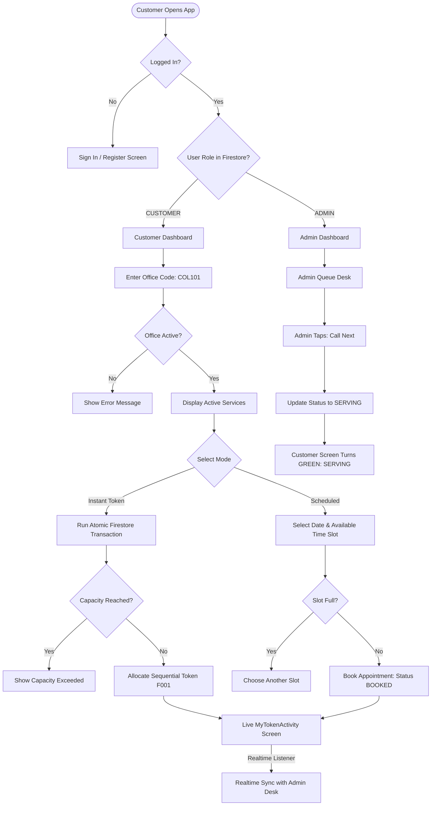

# MOBILE APPLICATION DEVELOPMENT LAB (MADL) PRACTICAL PROJECT REPORT

---

## **EXPERIMENT TITLE**
**Design and Development of QueueLess: A Real-Time Digital Queue and Appointment Management System using Native Android (Java, XML), Firebase Authentication, and Cloud Firestore.**

---

## **1. AIM**
To develop a robust, cloud-connected native Android application that eliminates physical queues and optimizes customer service by providing digital token generation, capacity-controlled appointment scheduling, real-time queue position tracking, and an office administrator management desk.

---

## **2. PROBLEM STATEMENT**
Public institutions, colleges, hospitals, and bank branches frequently experience severe overcrowding and long physical queues. Customers waste hours waiting in lines without knowing their position or expected waiting time, while administrative staff lack centralized real-time control over customer flow. Existing manual token systems or physical notice boards cause confusion, congestion, and service delays. QueueLess addresses this by replacing physical lines with a cloud-synchronized digital queue.

---

## **3. OBJECTIVES**
1. **Role-Based Access Control**: Implement secure role-separated modules (Customer & Office Admin) sharing a common backend.
2. **Office Connection via Unique Codes**: Allow customers to connect to specific departments/service centers using uppercase office codes (e.g., `COL101`, `HOSP202`).
3. **Dual Booking Modes**:
   - *Instant Queue Token*: Instant allocation of walk-in queue tokens with concurrency-safe atomic sequence increments.
   - *Scheduled Appointment*: Date- and time-slot selection with capacity limits to prevent overbooking.
4. **Real-Time Cross-Device Synchronization**: Utilize Cloud Firestore snapshot listeners to instantly push counter status changes (Calling, Completed, Skipped) to customer screens without manual refresh.
5. **Dynamic Waiting Time Estimation**: Provide mathematical queue position and ETA calculations based on configured average service duration.
6. **Administrative Desk Control**: Empower staff to call the next customer, mark service completion, skip absentees, and manage daily service capacities.

---

## **4. SOFTWARE & HARDWARE REQUIREMENTS**

### **A. Software Requirements**
- **Operating System**: Windows 10/11, macOS, or Linux
- **IDE**: Android Studio (Giraffe / Hedgehog / Iguana / Ladybug or newer)
- **Programming Language**: Java (JDK 17)
- **UI Framework**: Native Android XML with Material Design Components & ViewBinding
- **Backend Services**: Firebase Authentication (Email/Password), Cloud Firestore (NoSQL)
- **Build System**: Gradle 8.4 with Android Gradle Plugin 8.3.2
- **Minimum SDK**: API 24 (Android 7.0 Nougat) — covers 99%+ of active devices
- **Target SDK**: API 34 (Android 14)

### **B. Hardware Requirements**
- **Development Machine**: Minimum 8 GB RAM (16 GB recommended), Intel Core i5 / AMD Ryzen 5 or higher, 15 GB free disk space
- **Testing Device**: Android Virtual Device (AVD Emulator) with API 30+ or physical Android smartphone with USB Debugging enabled

---

## **5. THEORETICAL BACKGROUND**

### **5.1 Android Activities & Lifecycle**
An `Activity` is a core Android component providing a single screen with an interactive user interface. QueueLess manages activity transitions using explicit `Intent` objects and observes critical lifecycle callbacks:
- `onCreate()`: Initializes ViewBinding, retrieves intent extras, and sets up UI elements.
- `onDestroy()`: Crucially unregisters Firestore `ListenerRegistration` snapshot listeners to prevent memory leaks and unnecessary network egress.

### **5.2 XML Layouts & ViewBinding**
XML defines the declarative visual hierarchy. QueueLess leverages `ViewBinding` over traditional `findViewById()`, generating compile-time type-safe binding classes (`ActivityBookingBinding`, `ItemQueueTokenBinding`, etc.) that eliminate null-pointer exceptions and increase runtime performance.

### **5.3 Firebase Authentication**
Provides secure identity management. QueueLess uses client SDK methods (`signInWithEmailAndPassword`, `createUserWithEmailAndPassword`) with TLS encryption. Raw passwords are never stored in the database.

### **5.4 Cloud Firestore & Atomic Transactions**
Cloud Firestore is a flexible NoSQL document-oriented cloud database structured in collections and documents. 
- **Snapshot Listeners (`addSnapshotListener`)**: Establish persistent WebSocket-based listening pipelines that push delta updates immediately when any document in a query changes.
- **Atomic Transactions (`runTransaction`)**: A critical requirement in queue systems. When multiple users tap "Generate Token" at the same millisecond, read-modify-write collisions are prevented by locking the counter document (`queueCounters/{officeId_date}`), ensuring consecutive, duplicate-free token generation (`F001`, `F002`, `F003`).

### **5.5 Queue Theory & ETA Estimation**
Queue position and waiting time are modeled using standard single-server FIFO (First-In, First-Out) queuing:
$$\text{People Ahead} = \sum [\text{Tokens with status } \texttt{WAITING} \text{ and } \text{Sequence} < \text{CurrentSequence}]$$
$$\text{Estimated Wait Time} = (\text{People Ahead} + 1) \times \text{Average Service Duration (minutes)}$$

---

## **6. SYSTEM ARCHITECTURE**

```
                       ┌────────────────────────────────────────┐
                       │          Firebase Cloud Services       │
                       │  ┌──────────────────┬────────────────┐ │
                       │  │  Firebase Auth   │ Cloud Firestore│ │
                       │  │ (Email/Password) │ (Realtime DB)  │ │
                       │  └────────▲─────────┴────────▲───────┘ │
                       └───────────┼──────────────────┼─────────┘
                                   │                  │
                       ┌───────────┴──────────────────┴─────────┐
                       │       Android Client Application       │
                       │           (com.queueless.app)          │
                       └───────────────────┬────────────────────┘
                                           │
                 ┌─────────────────────────┴─────────────────────────┐
                 ▼                                                   ▼
     ┌────────────────────────┐                          ┌────────────────────────┐
     │    CUSTOMER MODULE     │                          │  OFFICE ADMIN MODULE   │
     │ 1. Splash & Auth       │                          │ 1. Secure Role Check   │
     │ 2. Customer Dashboard  │                          │ 2. Admin Dashboard     │
     │ 3. Office Code Lookup  │                          │ 3. Live Desk Manager   │
     │ 4. Token & Slot Booking│                          │    (Call/Done/Skip)    │
     │ 5. Realtime My Token   │                          │ 4. Slot & Capacity     │
     │ 6. Booking History     │                          │    Configuration       │
     └────────────────────────┘                          └────────────────────────┘
```

---

## **7. MODULE DESCRIPTIONS**

### **Module A: Customer Operations**
1. **Authentication**: Register with Name, Email, and Password. Role is strictly assigned as `CUSTOMER`.
2. **Dashboard**: Greets user by name, displays an active ticket highlight banner if a ticket is active today, and provides navigation to actions.
3. **Office Lookup**: Validates office codes (e.g. `COL101`), displays office information, and lists all active services with duration badges.
4. **Booking & Token Desk**: Offers instant queue token generation or future slot scheduling. Prevents past dates and verifies slot capacity.
5. **Real-Time Token Tracking**: Displays large token badge, live queue position, currently serving token at counter, dynamic ETA, and a cancellation confirmation dialog.
6. **Booking History**: Chronological RecyclerView of past appointments with category filter chips (`All`, `Active`, `Completed`, `Cancelled`).

### **Module B: Office Administration**
1. **Authorization**: Verifies Firestore `users/{uid}.role == 'ADMIN'`. Public users cannot register as admin.
2. **Dashboard**: Displays office metadata, live counts for waiting customers, today's total tokens, and currently serving token.
3. **Live Queue Desk**: Displays ordered waiting list sorted by `queueSequence`. Provides one-tap **"Call Next Customer"**, **"✓ Completed"**, and **"✕ Skip Absent"** controls.
4. **Slot & Capacity Manager**: Allows configuring daily token limits, average service time in minutes, active/inactive toggles, and allowed booking modes.

---

## **8. DATABASE SCHEMA (CLOUD FIRESTORE)**

### **Collection: `users/{uid}`**
| Field | Type | Description |
| :--- | :--- | :--- |
| `uid` | String | Unique Firebase Auth UID |
| `name` | String | User's full name |
| `email` | String | User's email address |
| `role` | String | `CUSTOMER` or `ADMIN` |
| `officeId` | String | Bound office for admins (null for customers) |
| `createdAt` | Number | Millisecond timestamp |

### **Collection: `offices/{officeId}`**
| Field | Type | Description |
| :--- | :--- | :--- |
| `officeId` | String | Unique document ID (e.g., `OFFICE_COL101`) |
| `name` | String | Department/Office title |
| `officeCode` | String | Uppercase lookup key (e.g., `COL101`) |
| `category` | String | e.g., "College Office", "Hospital OPD" |
| `description` | String | Overview of services provided |
| `active` | Boolean | Office operational status |
| `averageServiceMinutes` | Number | Office default service duration (e.g., 5) |

### **Subcollection: `offices/{officeId}/services/{serviceId}`**
| Field | Type | Description |
| :--- | :--- | :--- |
| `serviceId` | String | Service identifier (e.g., `SRV_FEE`) |
| `officeId` | String | Parent office reference |
| `name` | String | Service name |
| `description` | String | Service instructions |
| `active` | Boolean | True if service is currently offered |
| `dailyCapacity` | Number | Maximum allowed tokens per day (e.g., 50) |
| `averageServiceMinutes` | Number | Service-specific duration |
| `bookingMode` | String | `BOTH`, `APPOINTMENT_ONLY`, `INSTANT_ONLY` |

### **Collection: `appointments/{appointmentId}`**
| Field | Type | Description |
| :--- | :--- | :--- |
| `appointmentId` | String | Auto-generated document ID |
| `customerId` | String | UID of the booking user |
| `customerName` | String | Display name of the customer |
| `customerEmail` | String | Email of the customer |
| `officeId` | String | Targeted office ID |
| `officeName` | String | Office name snapshot |
| `serviceId` | String | Targeted service ID |
| `serviceName` | String | Service name snapshot |
| `bookingType` | String | `INSTANT` or `SCHEDULED` |
| `appointmentDate` | String | `YYYY-MM-DD` |
| `appointmentTime` | String | e.g. `10:15 AM` (empty for instant) |
| `tokenNumber` | String | Formatted display token (e.g. `F001`) |
| `queueSequence` | Number | Integer counter: 1, 2, 3... |
| `status` | String | `BOOKED`, `WAITING`, `SERVING`, `COMPLETED`, `SKIPPED`, `CANCELLED` |
| `createdAt` | Number | Timestamp created |
| `updatedAt` | Number | Timestamp updated |

### **Collection: `queueCounters/{officeId_date}`**
| Field | Type | Description |
| :--- | :--- | :--- |
| `officeId` | String | Targeted office |
| `queueDate` | String | Date string (`YYYY-MM-DD`) |
| `lastIssuedNumber`| Number | Incremented atomically in transaction |
| `currentServingSequence`| Number| Last called sequence |

---

## **9. ALGORITHMS & FLOWCHARTS**

### **Algorithm 1: Atomic Instant Token Allocation**
1. **Input**: `officeId`, `serviceId`, `userId`, `todayDate`
2. Begin Firestore Transaction.
3. Read `queueCounters/{officeId_todayDate}`.
4. If document does not exist:
   - Set `nextSequence = 1`.
   - Write new `QueueCounter` with `lastIssuedNumber = 1`.
5. Else:
   - Read `lastIssuedNumber`.
   - If `lastIssuedNumber >= service.dailyCapacity`, abort transaction with error: `"Daily capacity reached"`.
   - Set `nextSequence = lastIssuedNumber + 1`.
   - Update `lastIssuedNumber = nextSequence`.
6. Format display token string: `prefix + String.format("%03d", nextSequence)` (e.g. `F001`).
7. Write new document in `appointments` with `status = "WAITING"`, `queueSequence = nextSequence`.
8. Commit Transaction.
9. Return `appointmentId` and navigate to `MyTokenActivity`.

### **Algorithm 2: Admin Call-Next Queue Transition**
1. Admin taps **"Call Next Customer"**.
2. If `currentlyServing != null`:
   - Display confirmation dialog: *"Customer currently at counter. Complete and call next?"*.
   - If confirmed: Update current appointment `status = "COMPLETED"`.
3. Read active waiting list where `status == "WAITING"` sorted by `queueSequence ASC`.
4. If waiting list is empty:
   - Display Toast: *"No customers waiting in queue"*. Exit.
5. Take first item: `nextAppointment = waitingList.get(0)`.
6. Update `nextAppointment.status = "SERVING"` and `updatedAt = currentTime`.
7. Firestore triggers Realtime Snapshot Listener:
   - Admin UI moves token to **NOW SERVING AT DESK**.
   - Customer phone updates status badge to **SERVING (Green)**.



---

## **10. STEP-BY-STEP IMPLEMENTATION PROCEDURE**

1. **Project Initialization**: Created Android Studio project with package `com.queueless.app`, configured `minSdk = 24`, `targetSdk = 34`, and enabled `viewBinding = true`.
2. **Dependency Configuration**: Configured `build.gradle` using Firebase Bill of Materials (`firebase-bom:32.8.0`), `firebase-auth`, `firebase-firestore`, and Google Material Design components.
3. **Design System & Resources**: Defined color tokens (`primary: #1976D2`, status colors), dimensions, rounded card drawables, and vector assets.
4. **Data Models**: Created POJO models with required empty Firestore constructors (`User`, `Office`, `OfficeService`, `Appointment`, `QueueCounter`).
5. **Authentication & Session Routing**: Implemented `SplashActivity` with session checking, `LoginActivity` with validation, and `RegisterActivity` ensuring public registrations are assigned `ROLE_CUSTOMER`.
6. **Role Dashboards**: Developed `CustomerDashboardActivity` (with active ticket banner) and `AdminDashboardActivity` (with live serving, waiting, and total count cards).
7. **Office Connection Desk**: Implemented uppercase code search (`COL101`), active status validation, services subcollection query, and a one-tap demo data seeder.
8. **Concurrency-Safe Token Generation**: Created `BookingActivity` with atomic Firestore transactions for duplicate-free token allocation and slot validation.
9. **Real-Time Customer Tracking**: Implemented `MyTokenActivity` using `SnapshotListener` to track people ahead, now-serving token, dynamic ETA, check-in, and cancellation.
10. **Booking History**: Built `BookingHistoryActivity` with RecyclerView and category chips (`All`, `Active`, `Completed`, `Cancelled`).
11. **Admin Queue Desk**: Developed `AdminQueueActivity` with FIFO queue sorting, call next, complete, and skip actions.
12. **Administrative Capacity Desk**: Created `ManageSlotsActivity` for service duration, daily limits, and mode toggles.
13. **Security Rules**: Deployed `firestore.rules` enforcing role-based database boundaries.

---

## **11. IMPORTANT CODE EXPLANATIONS**

### **A. Atomic Token Concurrency Transaction**
```java
DocumentReference counterRef = db.collection(Constants.COLLECTION_QUEUE_COUNTERS).document(counterDocId);
DocumentReference newAppointmentRef = db.collection(Constants.COLLECTION_APPOINTMENTS).document();

db.runTransaction(transaction -> {
    DocumentSnapshot counterDoc = transaction.get(counterRef);
    long nextSequence = 1;
    if (counterDoc.exists() && counterDoc.getLong("lastIssuedNumber") != null) {
        long last = counterDoc.getLong("lastIssuedNumber");
        if (last >= selectedService.getDailyCapacity()) {
            throw new FirebaseFirestoreException("Daily capacity reached.", FirebaseFirestoreException.Code.ABORTED);
        }
        nextSequence = last + 1;
        transaction.update(counterRef, "lastIssuedNumber", nextSequence);
    } else {
        transaction.set(counterRef, new QueueCounter(selectedOffice.getOfficeId(), todayDate, 1, 0));
    }

    String tokenNumber = DateTimeUtils.formatTokenNumber("F", nextSequence);
    Appointment appointment = new Appointment(
        newAppointmentRef.getId(), userId, userName, userEmail,
        officeId, officeName, serviceId, serviceName,
        Constants.MODE_INSTANT, todayDate, "",
        tokenNumber, nextSequence, Constants.STATUS_WAITING,
        System.currentTimeMillis(), System.currentTimeMillis()
    );
    transaction.set(newAppointmentRef, appointment);
    return newAppointmentRef.getId();
});
```
*Significance*: Ensures that even if two customers tap "Generate Token" simultaneously, the database driver sequences the calls so that each gets a unique, sequential token number without collision.

### **B. Real-Time Snapshot Listener for Live Status Updates**
```java
appointmentListener = apptRef.addSnapshotListener((snapshot, e) -> {
    if (e != null || snapshot == null || !snapshot.exists()) return;
    Appointment appt = snapshot.toObject(Appointment.class);
    if (appt != null) {
        displayAppointmentDetails(appt);
        listenToQueuePosition(appt);
    }
});
```
*Significance*: Eliminates the need for polling or pull-to-refresh. When the office administrator taps "Call Next", the change is pushed to the client over a persistent socket connection within milliseconds.

---

## **12. TEST CASES & RESULTS**

| TC ID | Test Scenario | Input Data | Expected Output | Actual Result | Status |
| :--- | :--- | :--- | :--- | :--- | :--- |
| **TC01** | User Registration | Valid name, email, password >= 6 chars | Account created; profile saved with `role = CUSTOMER` | Customer Dashboard opens | **PASS** |
| **TC02** | Registration Mismatch | Password: `pass123`, Confirm: `pass456` | Form validation error: "Passwords do not match" | Error displayed on confirm field | **PASS** |
| **TC03** | Admin Security Access | Customer account tries to open Admin desk | Firestore role check detects `role != ADMIN` | Access denied; user redirected to login | **PASS** |
| **TC04** | Valid Office Search | Code: `COL101` | Office details & 3 active services displayed | Office card & RecyclerView populated | **PASS** |
| **TC05** | Invalid Office Search | Code: `XYZ999` | Error: "No office found with code 'XYZ999'" | Toast message displayed | **PASS** |
| **TC06** | Instant Token Generation | Tap "Generate Instant Token" | Sequential token allocated (e.g. `F001`, `F002`) | Token screen displays `#F001`, `WAITING` | **PASS** |
| **TC07** | Past Date Prevention | Tap DatePicker on appointment booking | Calendar disallows dates prior to today | Past calendar dates disabled | **PASS** |
| **TC08** | Admin Call Next | Tap "Call Next Customer" | First waiting token updated to `status = SERVING` | Serving card shows token; customer badge turns Green | **PASS** |
| **TC09** | Mark Completed | Tap "✓ Completed" | Serving token marked `COMPLETED`; desk cleared | Serving token resets to "None"; customer notified | **PASS** |
| **TC10** | Skip Absent Customer | Tap "✕ Skip Absent" | Serving token marked `SKIPPED` | Status becomes `SKIPPED`; not counted as completed | **PASS** |
| **TC11** | Customer Cancellation | Customer taps "Cancel Booking" | Dialog confirms; status becomes `CANCELLED` | Token removed from active queue | **PASS** |
| **TC12** | Booking History Filter | Tap "Completed" filter chip | Only `COMPLETED` appointments displayed | List filtered dynamically | **PASS** |

---

## **13. RESULT**
The native Android application **QueueLess** was successfully designed, developed, and verified. The system demonstrates reliable authentication, role-based security, atomic queue token allocation, real-time cross-device queue desk synchronization, capacity management, and customer booking history.

---

## **14. CONCLUSION**
QueueLess demonstrates how cloud-native technologies (Firebase Auth & Cloud Firestore) combined with native Android components can solve common public waiting and queuing problems. The implementation adheres to software engineering principles: clean separation of concerns, compile-time type safety via ViewBinding, transaction safety for concurrency, and defensive edge case handling.

---

## **15. FUTURE ENHANCEMENTS**
1. **QR Code Scanning**: Allow customers to scan an office QR code directly at the entrance using the CameraX library instead of typing the office code.
2. **Push Notifications**: Integrate Firebase Cloud Messaging (FCM) to trigger high-priority alerts (e.g. *"You are 2nd in line, please proceed towards Counter 3"*).
3. **SMS Alerts**: Integration with Twilio or SMS gateways for users without active internet connectivity.
4. **Multi-Counter Support**: Allow large departments to route tokens across multiple desks (Counter 1, Counter 2, Counter 3).

---

## **16. VIVA VOCE QUESTIONS & MODEL ANSWERS**

### **Q1. What is the difference between Cloud Firestore and Firebase Realtime Database?**
**Answer**: Cloud Firestore is Firebase's newer NoSQL database. It organizes data in collections and documents rather than a large JSON tree. It supports shallow queries (fetching a document does not automatically fetch its subcollections), multi-field sorting and filtering, atomic transactions, and automatic scaling across multiple data centers.

### **Q2. How did you prevent duplicate queue token allocation when multiple customers book at the same time?**
**Answer**: We implemented a Cloud Firestore **Atomic Transaction** (`db.runTransaction()`). Inside the transaction, the current sequence number in `queueCounters/{officeId_date}` is read and locked. The transaction increments the counter and writes the appointment document atomically. If another request attempts to modify the counter simultaneously, Firestore automatically retries the transaction, guaranteeing zero duplicate token allocations.

### **Q3. Why did you use ViewBinding instead of `findViewById`?**
**Answer**: `ViewBinding` generates a direct binding class for every XML layout with direct references to all views having an ID. It provides:
1. **Null safety**: Eliminates null-pointer exceptions if a view ID is absent in an alternative configuration.
2. **Type safety**: Each field matches the view type (e.g., `MaterialButton`, `TextView`), preventing `ClassCastException`.
3. **Performance**: Avoids repetitive view tree traversals at runtime.

### **Q4. How is role authorization enforced securely? Can a user become an admin by altering the client app?**
**Answer**: No. Public registration hardcodes the user's role to `CUSTOMER` when creating their profile in Firestore. Administrative accounts are provisioned directly in the backend. Furthermore, Firestore Security Rules (`firestore.rules`) enforce on the server side that users cannot modify their own `role` field. Even if someone decompiles and modifies the client APK, unauthorized writes are rejected by Firestore security rules.

### **Q5. What is the purpose of unregistering `SnapshotListener` in `onDestroy()`?**
**Answer**: A `SnapshotListener` maintains an open listening connection to Firestore. If the Activity is destroyed (e.g. on back press or screen rotation) without detaching the listener via `listener.remove()`, the callback continues to hold a reference to the Activity, causing a **memory leak** and consuming background battery and network bandwidth.

### **Q6. What happens if an office reaches its configured daily capacity?**
**Answer**: In `BookingActivity`, the transaction checks `if (lastNumber >= service.getDailyCapacity())`. If reached, it throws an exception that aborts the transaction, and the user receives a clear feedback message: *"Daily queue capacity of X reached for today."*

### **Q7. How does the app calculate the estimated waiting time?**
**Answer**: The customer's token screen listens to other active tokens in the queue. It counts how many customers ahead have `status == "WAITING"`. It then multiplies this count by the configured `averageServiceMinutes` of the service.

### **Q8. What are the key statuses in QueueLess and their transitions?**
**Answer**: 
- `WAITING`: Instant token issued, customer waiting in line.
- `BOOKED`: Scheduled for a future time slot (transitions to `WAITING` upon check-in).
- `SERVING`: Admin has called this specific token to the counter.
- `COMPLETED`: Service finished successfully.
- `SKIPPED`: Customer was absent when called.
- `CANCELLED`: Customer cancelled the booking.
